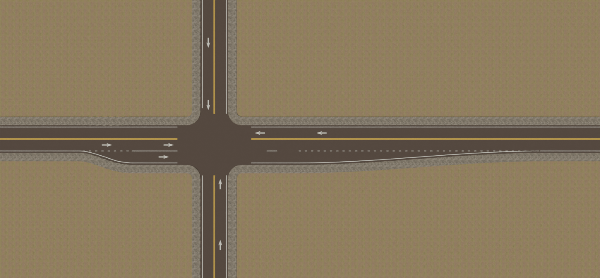
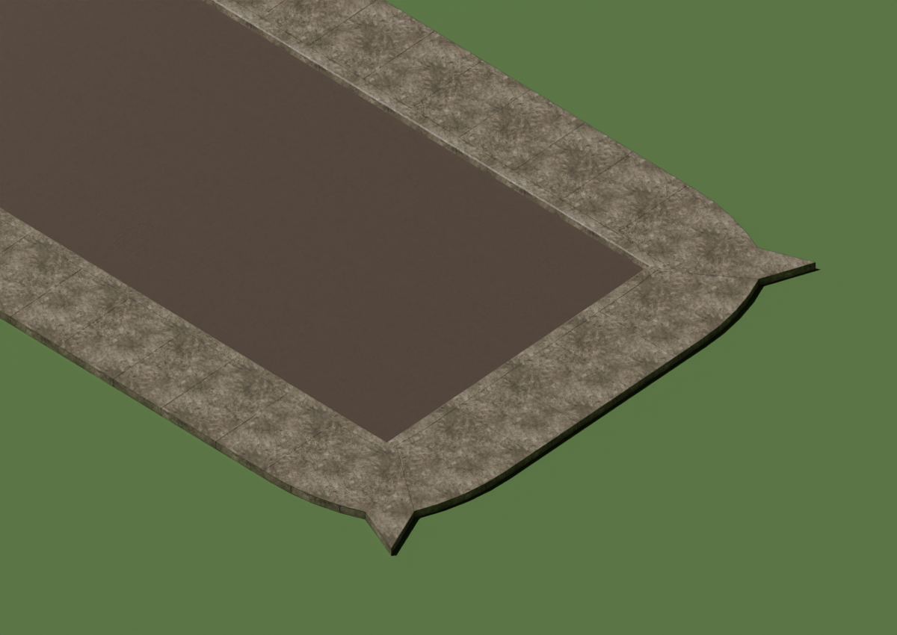
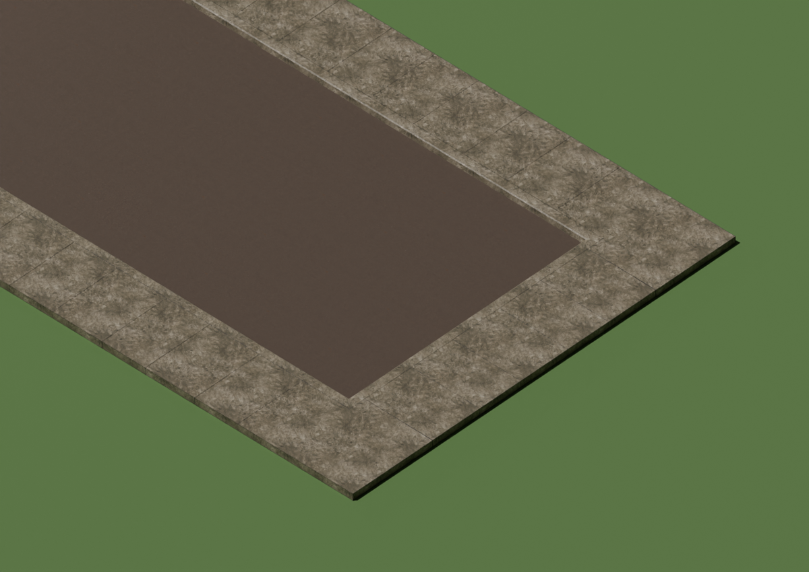
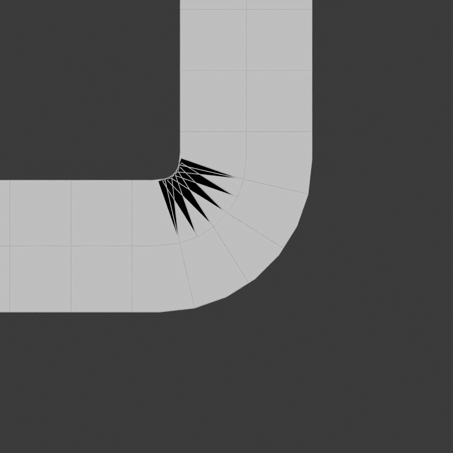
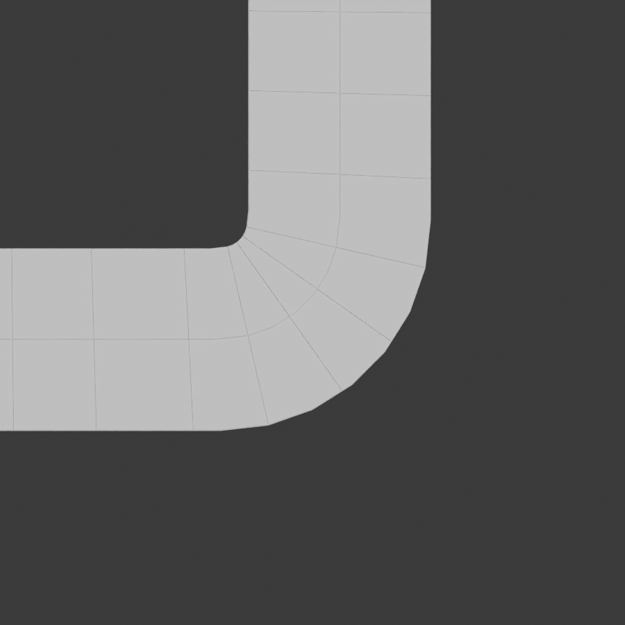

# RoadLab Blender extension and update repository

The full RoadLab 0.18.31 addon is integrated here, including lane markings and quad terrain. Requires Blender **5.1 or later**.

## Install once

1. Save your project. Disable the older **RoadLab** legacy addon in Preferences > Add-ons, then restart Blender. The legacy addon and extension register the same tools and must not run together. Existing project data is retained.
2. Enable **Allow Online Access** in Preferences > System if it is disabled. Then Preferences > Get Extensions > Repositories > Add Remote Repository. Paste:
   `https://raw.githubusercontent.com/hitxne/world-builder/feature/road-lab-updater/road-lab-updater/dist/stable/index.json`
3. Name it RoadLab and enable **Check for Updates on Startup**. Refresh repositories, find **RoadLab**, and install it from this repository.
4. RoadLab > Updates shows the startup check setting and opens Get Extensions. Blender checks for newer versions; use its Update action to install them. This is not a silent forced updater.

Do not first install this ZIP into a different local repository and then install a second copy from the remote feed. Install from the RoadLab remote repository so Blender can associate the addon with its update source.

## Release workflow

`extension/` is the canonical source for this branch. `extension/RoadLab/` contains the working addon; `extension/updates.py` integrates Blender repository settings. The addon data identifiers remain unchanged so previous .blend scenes keep their authoring data.

For each release, increase **both** `extension/blender_manifest.toml`'s version and `extension/RoadLab/__init__.py`'s addon version. Test compatibility before committing. Blender detects updates only when the feed lists a higher compatible version.

Push source changes to `feature/road-lab-updater`. The GitHub workflow validates/builds the ZIP and commits the generated `dist/stable/index.json` and archive to this branch. The public raw GitHub path hosts both. Generated feed commits do not retrigger the workflow. If branch protection blocks the workflow push, publish the generated files through a reviewed PR instead. No tokens ship in the addon.

Build locally:

```sh
BLENDER=/path/to/blender bash road-lab-updater/tools/build_repository.sh
```

Rollback: disable/remove the extension, then install a previous archived package after backing up the project. Repository checks do not edit project files.

## Marking and stamp update (0.18.0)

With a RoadLab road selected in Object or Edit Mode, choose **Marking Stamp** in the left toolbar (or RoadLab > Marking Stamp > Use Marking Stamp). Entering the tool switches to top-down orthographic view; leaving it restores the previous view. Select a decal, size and rotation in the tool header. Move over the road to preview its footprint; green fits, red does not. Click to place. Undo or Remove last stamp removes a placement. Manual stamps are separate from the automatic lane layout and follow their source road segment through ordinary edits. Stamps whose footprint no longer fits are skipped with a sidebar notice.

Lane window > Markings now exposes arrow spacing, solid approach length, entry-dot length, arrival control at each end, and stop setback. The selected lane's **Lane entry** field distinguishes Continuous from Added lane. Stop and Traffic signals draw a 0.61 m stop bar across arriving lanes at junctions; Yield and Uncontrolled do not. Ordinary lane dividers remain broken away from junctions, become solid in the configured approach section, and use short entry dots for designated added lanes.

The entry setting controls paint, not a generated widening taper. Enabled crosswalks move the stop bar behind the furthest crossing endpoint; the setback control adds clearance. Marking rules are based on FHWA MUTCD 11th Edition, Revision 1, Sections 3A.04, 3B.07, 3B.11, and 3B.19. Traffic-signal timing and NPC simulation remain separate future work.

## Start from a blank scene (0.18.1)

Delete the default cube. Add a mesh plane and scale it to the desired map size (S, 100 makes the default plane 200 m wide). In Object Mode, select the plane, press N, open RoadLab > Scene, and click **Use selected mesh as terrain**. An unmaterialed plane gets the default grass material; existing materials are preserved.

Click **Create Road** in the same Scene panel. It creates a 30 m editable alignment at the 3D cursor, selects the new road, and connects its grading to the designated terrain. Press Tab to edit. Select an endpoint and E to extend; G to move; G then Z to change elevation. Terrain follows after placement. Road defaults holds width and sample spacing. Use Add road branch in Edit Mode for junctions in the same network.

Select the terrain in Object Mode to use Raise, Lower, Flatten and Smooth with adjustable radius and strength. Use Material Preview to see decal textures.

## Approach-only arrows (0.18.2)

Automatic arrows are now drawn only before an actual junction, never on receiving lanes pointing away from that junction. On a segment connecting two junctions, each direction can receive arrows before its own destination junction; the opposite departure half stays clear. Markings > Arrow approach controls the upstream extent (default 35 m; zero disables automatic arrows). Manual stamps remain user-placed. Existing lane assignments inherit the corrected behavior when regenerated.

## Lane window guidance (0.18.2)

The lane window opens with usage instructions when no valid selection exists. In Edit Mode, select one junction location (coincident handles are accepted), or adjacent points along one street. Opening the tool preserves a selected junction. The active edited road takes priority over a stale Scene road assignment. Alt-click with Marking Stamp erases painted markings; Restore automatic markings clears suppression.

Completed releases are always published to the automatic updater on `feature/road-lab-updater`. Standalone ZIPs are supplemental.

## Clear junction controls (0.18.3)

Choose **Edit road from** using direction names computed from the actual connected roads. North is map +Y and East is +X, independent of the viewport. The chosen arm is highlighted orange while the lane window is open. Arriving at junction and Leaving junction replace ambiguous incoming/outgoing headings. Apply saves the chosen arm; reopen to edit another. Guides disappear on Apply, Cancel, or disabling the extension.

## Focused lane workflow (0.18.4)

The lane window has three pages: **Lanes**, **Markings**, and **Road size**. Detail sections start collapsed on each opening. Lanes shows one travel direction at a time, with the lane count, movement choices, widths, and optional entry details. Markings groups arrows, lane lines, and stop lines separately. Road size holds total width, median, section direction, and the confirmed clear action. Junction stop-line controls refer to arrivals at the selected junction; controls for the far end are available by selecting that street section.

Switching junction roads preserves pending edits. Apply validates every edited road before writing any setup and saves them together. If roads need more width, a single expansion confirmation lists the affected roads. Cancel leaves committed road setups unchanged.

## Apply without closing (0.18.5)

**Apply lanes** saves inside the lane editor. The current road, page, open sections, pending drafts, and viewport guide remain available. Width expansion is reviewed and approved inline; changing the request requires reviewing the new dimensions. Invalid changes show an inline message and keep the draft editable. **Done** closes the editor without implicitly saving pending changes. Applied changes remain saved when the editor closes.

## Connected markings and live preview (0.18.6)

Lane and marking edits preview in the viewport without modifying saved lane assignments, pavement, terrain, or manual stamps. Apply commits the draft; Done or Cancel discards changes since the last Apply. The preview is removed before saving a .blend and resumes afterward. A draft that needs wider pavement requests expansion on Apply.

Two-road connection vertices can be selected with the Lane tool. Choose **Continuous street** for joined curved markings or **Stop-controlled** for separated road-end markings and arrival stop lines. The choice is stored at the vertex, survives extension and later branches, and is independent of corner sharpness. This sets marking control; physical sign assets and traffic simulation are separate.

Endpoint extensions inherit an existing street profile when the continuation is unambiguous. New branches at a multi-road junction are not assigned an arbitrary profile. At two-arm bends, paint follows the same rounded side boundaries as the road surface. Differing lane counts receive divider tapers; on straight connections, Markings > Lane lines > Lane merge length controls the transition corridor. Width remains subject to explicit expansion approval. Unsupported median or opposing one-way changes retain a gap with a warning rather than inventing a crossing. These marking transitions are not simulated traffic routing.

## Preserve markings when adding streets (0.18.7)

Adding a branch preserves the existing lane profiles and center, edge, and divider lines. If a new junction makes a saved movement unavailable, only its unsupported directional arrows are suppressed; the lane window flags the movement for review. Applying a new lane setup still validates its movements.

Subdividing a marked source edge transfers its profile and interpolated width to the resulting edges, preserving travel orientation and the controls at the two original endpoints. Collinear subdivisions already affected by earlier versions are repaired when markings regenerate. Ambiguous or removed routes still require explicit reassignment. New branches remain unassigned rather than copying an arbitrary road profile.

## Editable example entry point (0.18.8)

Use **RoadLab > Scene > Load example** for an editable road curve on a connected terrain plane. This opens a separate Blender scene and preserves the previous scene. The curve is selected; Tab enters curve Edit Mode with six authoring points. Move an endpoint with G, then Z to raise it and see terrain grading follow. Terrain remains an editable source plane, with a derived quad grading surface. The asphalt display is generated geometry; the hidden reference mesh is not the editing object.

The older standalone triangulated examples are diagnostic mesh fixtures, now explicitly labeled under **RoadLab Debug > Mesh test fixtures**. They are not the editable road-and-terrain workflow. Road and terrain reference collections are scoped to their scene, so repeated example loads do not add helpers to an earlier scene.

## Crosswalk positions and ramps

In curve Edit Mode, select a junction or adjacent street points and open the Lane tool. Under **Markings > Crosswalk**, enable the crossing, then adjust **A-end position** and **B-end position** independently to skew it. Positive offsets move away from the junction. Amber A/B labels identify the endpoints in the viewport. Preview updates live; Apply saves without closing.

Existing curb and sidewalk layers lower at each endpoint and return to their own profile height over **Ramp run**. Moving either crossing endpoint moves its ramp. Cancelling the lane window restores saved ramps, and temporary previews are excluded from saved files. Add curb and sidewalk layers first on custom roads; the editable example includes both. Optional yellow tactile pads project onto these surfaces, falling back to assigned terrain. Their raised-dot appearance uses a bump shader, not modeled dome geometry.

## Connecting roads with F (0.18.9)

Joining or closing source splines preserves existing point identities and lane assignments, including when Blender reverses point order. New connecting edges inherit matching lane profiles from both ends; differing profiles remain unassigned for review rather than choosing one arbitrarily. Ordinary point movement preserves its settings.

Crosswalk ramp guides sample the finished road edge instead of the source segment height, so lifting a junction preserves ramp and tactile-pad clearance over terrain. Direct road and marking rebuilds guard against re-entry from dependency-graph evaluation.

## Concrete sidewalks and interior connections (0.18.10)

Sidewalks preserve perimeter corners, use corrected polyline offsets, and shade concrete faces flat. A non-destructive **RoadLab Planar Slabs** modifier dissolves nearly coplanar faces (0.1-degree tolerance) while retaining bends and ramp creases. The default editable example drops from 46,384 to 2,021 evaluated sidewalk vertices. This produces planar slab polygons rather than a dense uniform grid; terrain remains quad-based. Curb profiles flatten into crossing grade instead of translating their toe below the terrain. Existing layers upgrade when opening a file or enabling the extension.

With a RoadLab source curve selected in Edit Mode, select two points and press **F** or use **Connect selected points (F)** under Road defaults. Endpoint pairs use Blender's native join. If either point is inside a street, RoadLab adds a connecting spline while preserving the through street and its lane assignments. This shortcut only overrides F for RoadLab core curves. New junction movement permissions remain editable in the Lane tool.

## Surface Bounds (0.18.11)

In **Object Mode**, choose **Surface Bounds** in the left toolbar. Set **Surface** in the tool header to **Sidewalk**, **Curb island**, **Median**, or **Parking lot**. Click outline corners, then press **Enter** or click the first corner to finish. **Backspace** removes a corner; **Esc/right-click** cancels. The new editable mesh plane opens in Edit Mode. Move, subdivide, or extrude its boundary with Blender's normal controls; Geometry Nodes update the generated surface without replacing the source. Concave outlines are supported; the drawing tool rejects crossed outlines.

For a starting square instead, use **RoadLab > Surface Bounds > Create editable plane**. The panel is collapsed by default. Surface height, slab thickness, corner radius and optional curb are controlled there. Islands and medians start with grass and a concrete curb; parking lots start with asphalt. **Follow terrain** samples the assigned terrain and ground road. Flat/sloped planes stay simple; changing ground normals add interior geometry, with **Terrain detail** under the collapsed **Ground and Road** section. Disable Follow terrain to shape elevation by moving the source vertices. Ground and road assignments can be changed per surface.

**Trim overlaps** removes overlap with the assigned ground road and existing enabled curb/sidewalk layers. Trimming uses nearby face bounds, including long planar slabs. Existing road sources and layers remain editable. Bridge-cut road decks are excluded from the road footprint. Save/reopen preserves surface type, unique identity, source plane, targets and node settings.

This feature defines editable surface geometry. Parking stalls, planter-island cutouts, NPC lane connections and automatic crosswalk routing across new pads are separate systems; surface type alone does not generate them.

The 0.18.12 sidewalk preset uses a 0.20 m slab below its 0.1524 m surface rise, so a new pad embeds into grade instead of floating over it. Existing custom thickness settings remain unchanged.

### 0.18.13 — offline PBR surfaces

Grass, asphalt, concrete, sidewalks and gutters use bundled CC0 Poly Haven 1K
base color, roughness and OpenGL normal maps. Maps use world-space meter scale,
box projection and surface-oriented normals without requiring a UV unwrap.
Images are shared and packed into saved scenes; no texture download is needed
at runtime and no displacement subdivision is added. Sidewalks and curbs use
Concrete Floor 02, asphalt uses Asphalt 03, and grass uses Leafy Grass.

Select a road, assigned terrain or Surface Bounds object and open **RoadLab >
Surface materials** to adjust shared texture repeat size in meters. Full material
nodes are editable in Blender's Shader Editor. Original plain RoadLab materials
upgrade on addon enable or file load. Materials with user-authored nodes are
preserved. Use Material Preview or Rendered view to see texture detail.

This release adds PBR surfaces, not the terrain paint brush or irregular
asphalt/grass boundary blend. Those require independent layer masks. Grass is
a flat ground texture; close-up silhouettes will require optional grass instances.
Asset URLs and CC0 license information are in `RoadLab/textures/LICENSE.md`.

### 0.18.14 — preserve the example environment

Load Example copies the current scene's World (sky/HDRI nodes and settings),
render engine and color management into the separate example scene. The World
copy is independent, so changing it does not change the original scene's World.
The viewport keeps its existing shading mode and environment preview settings.
Your original scene stays available in Blender's scene selector.

This release contains the environment-preservation fix only. The new lane-pocket
and sidewalk-panel work is not included until its final validation can complete.


### 0.18.15 — local lanes and concrete panels

In road curve Edit Mode, select a point or a connected run and choose **Add lane**
from the Lane toolbar tool or RoadLab > Lanes. A blue preview evaluates the actual
pavement, curb and sidewalk geometry. **Change side of street** flips the widening.
Confirm **Add lane** to save; Cancel removes the preview without changing the road.
The authored curve points stay intact. A single point makes a local pocket; a run
spans those points. Adding an adjacent point extends the existing pocket, retaining
its width and entrance instead of stacking a second widening. Remove a saved pocket
with its trash button in Lanes.

Selecting a junction offers its actual compass-named approaches. **Turn lane** adds
a dedicated curb-side or median-side turn and checks that its destination exists
and has sufficient receiving lanes. **Through lane** creates a linked receiving lane
on the actual opposite street, then merges it back after the junction by default.
Both halves preview and save together; removing the through lane removes its merge.
The receiver must have enough length for the full-width section and taper. Ambiguous
through destinations and overlaps show a message before commit. Traffic side comes
from the global map setting. These are geometry and marking controls; NPC traffic
routing and signal timing are not implemented by this update.

The receiving merge defaults to 71.46 m for a 3.5 m lane at an assumed 35 mph. This
uses the merging-taper equation in the [2026 FDOT Design Manual, section 212.6](https://fdotwww.blob.core.windows.net/sitefinity/docs/default-source/roadway/fdm/2026/2026fdm212intersections.pdf?sfvrsn=cb5713fa_6):
L = W × S² / 60 at 40 mph and below, L = W × S at 45 mph and above, with W and L in
feet. The width conversion cancels when both use meters. The merge length is editable;
the default is a game-authoring starting point, not a complete road-safety assessment.
Turn-pocket storage and entry tapers remain separate controls. Long gentle tapers
avoid sub-micron arc triangles that would collapse at mesh coordinate precision.

Sidewalks now form capped concrete panels with separate slab length, slab width and
joint-gap controls inside the sidewalk layer. Defaults target approximately 1.5 m
blocks with 3 mm joints. Straight slabs dissolve to simple flat faces; curves and
crosswalk ramps retain the geometry needed for their shape. Untouched stock profiles
embed below grade, and the layer stack separates the curb and sidewalk with a small
construction joint. Custom profile shapes are preserved during upgrade. These changes
do not add terrain painting or an irregular asphalt/grass blending mask.


Curved marking paths now retain surface-projection samples along their length.
A single edge-of-road ray miss no longer removes an entire long line on a neighboring
street when a widened junction shifts its end. Receiving merge lanes keep the departure
area free of automatic approach arrows.

Actual Blender render of a through lane, its receiving lane and downstream merge:



### 0.18.16 — lighter surface updates and stable panel frames

Road edits now defer paint and ramp regeneration until terrain seam updates finish.
One committed edit makes one final marking pass instead of repeatedly evaluating all
curb and sidewalk geometry for tactile-pad projection. Sidewalk slabs simplify before
Boolean cleanup. Extra cross-section samples are generated only on panels close enough
to reach a crosswalk ramp; ordinary blocks keep their simple cross-section. Exact cleanup
is retained, and the final surface still uses the existing corner and ramp controls.
Road mesh attributes, UVs and perimeter coordinates use batch writes. Unrelated depsgraph
updates no longer resynchronize every layer model. Moving a point retains its custom
width/offset/height values and avoids replacing its attribute mesh.

Panels now use the finished road border's original frame and profile coordinates.
Open runs are aligned to their stored source direction. Splitting a block can no longer
invert its height. The
flat example's 578 panels share the same top height; tests also check straight and rotated
road-end bounds, upward top normals, point-field persistence and one paint pass per edit.
Existing sidewalk modifiers upgrade to sweep → planar simplification → surface finish;
layer controls stay in the same sidebar sections.

Measured in Blender 5.1 background mode with four worker threads on the supplied example
with tactile crosswalks: a small committed point edit fell from 14.56 s to 1.79–2.13 s.
Example load fell from 17.45 s to 5.11 s. Dense sidewalk input fell from about 108k to
33k vertices, with approximately 8.4k final vertices. These are sample-scene measurements,
not a viewport frame-rate claim or a large-map benchmark. Reproduce edit timings with
`blender -b --factory-startup -t 4 --python road-lab-updater/tools/benchmark_edit.py`.
Auto mode still defers expensive commits during dragging when they exceed its live budget.


### 0.18.17 — correct road-end offset frames

The close-up visual check exposed a second cause of end-cap tips after the height
fix: subdividing a border interpolated its Free normals around sharp corners. A
miter using those blended normals pulled adjacent points inward and left pointed
wings at the corners. Overall bounding-box tests did not detect that pinch.

Border normals are now recomputed from actual neighboring polygon edges. The
regression checks the entire outer contour against an analytical rectangular
road-end offset, in addition to straight/rotated bounds, panel heights and normals.
The previous shape failed by roughly 28 cm at one sampled point; the corrected
contour passes the 5 mm tolerance. Performance changes from 0.18.16 are retained.

The corrected flat example finishes at approximately 7.5k sidewalk vertices, with
all 578 panels at their intended top elevation.

Before recomputing border normals (the end-cap pinch is visible):



After the contour correction, with panel edges shown for inspection:




### 0.18.19 — Blender 5.1 and 5.2 input compatibility

Geometry Nodes input reads, writes and sidebar controls now use Blender 5.2's
RNA inputs when available, retaining Blender 5.1's modifier property access.
Layer staging, profile editing and original terrain adapters use the same access
helpers. Integer Compare nodes resolve typed operands instead of relying on
indices that changed in 5.2. The release workflow tests both Blender versions
before publishing the update feed.


### 0.18.20 — road sculpt grading and bounded terrain falloff

Road elevation brushes now update a temporary terrain surface during the stroke.
Ground-contact edges drive the existing blend-distance falloff; bridge cuts stay
excluded. Cached edge bindings update heights without running the terrain topology
compiler per stamp. Finishing commits the graded quad terrain; cancel restores the
previous terrain and road. Widening still uses a topology rebuild because its footprint
changes. Terrain brushes continue to leave roads fixed.

Terrain grading blends the road-edge and original ground heights directly with a
smooth quintic falloff. It no longer extrapolates a steep edge slope into a hole or
ridge outside the road. The terrain source plane and its sculpt field are preserved.
Blender 5.1 and 5.2 remain supported.

Brush hover feedback now uses Blender's native tool cursor callback instead of
gizmo hit testing. Selecting a road or terrain sculpt tool shows its footprint on
hover before the first click, including when viewport gizmos are hidden.

Road raise/lower/flatten/smooth and bank sessions now keep sparse brush values in
memory, update only nearby pavement/perimeter/paint samples, and grade nearby terrain
through cached edge bindings. Road compilation, paint regeneration and field JSON
serialization are deferred until the stroke finishes. The width brush batches point
metadata synchronization across splines. Brush calculations run on timer events,
coalescing mouse moves to the most recent cursor position. Width still recompiles
its changing footprint; no whole-map viewport FPS guarantee is implied.

Edit-mode road extension/movement queues a lightweight translucent blue ribbon for
changed segments only. It is a provisional straight-segment footprint; final rounded
junctions, terrain and markings still come from the normal compiler after placement.
Mouse changes coalesce before ribbon generation, GPU batches are reused between
changes, and committed edits replace the overlay with completed geometry.


### 0.18.21 — ordered sidewalk offsets and width drafts

Tight inside corners previously reversed dense border samples as the sidewalk
offset consumed their intervals. Computing miters at those inserted samples also
folded slab top faces. The node group now removes redundant collinear knots, builds
true offset vectors at the original polygon corners, and interpolates those vectors
as a whole before splitting panels. A 3.2 m sidewalk at a 4 m corner radius reproduced
approximately 3.17 square meters of overlapping top surface before the correction;
the corrected fixture has no measurable top-surface overlap or self-crossing faces.
Corner tests cover 45/90/135 degree turns, multiple resolutions and widths through
10 m, checking the raw sweep and final surface. Tight inside corners taper where
the available space cannot contain the full width; straight sections retain it.

In RoadLab > Edge layers > Sidewalks, expand a layer and choose **Adjust…**
beside Width. The popup displays an isolated blue width draft and moves following
layers outward. In Edit Mode it targets selected road points; in Object Mode it
targets the whole road. **Accept width** commits the settings and evaluates the
concrete panels. Cancel restores visibility and removes all draft helpers without
changing the source width. The draft uses a continuous band for responsiveness;
final slab divisions and cleanup remain in the existing node stack.

Actual Blender renders with polygon edges shown:





## Saved sidewalk corner repair (0.18.22)

Opening a scene now replaces the older sidewalk offset node graph with the corrected corner frames. The previous version accepted schema 18 as current, so existing .blend files could keep folded black corner fans despite updating the add-on. Layer settings and modifier socket identifiers are preserved. Update, restart Blender, and reopen the scene; no layer recreation is required.

## Parking entrances and sculpted sidewalks (0.18.23)

Parking bounds assigned to a road automatically lower overlapping curb and sidewalk layers for driveway access. Both sides along the sidewalk use the same ramp length. Surface Bounds > Parking lot > Driveway crossings enables this by default; Ramp length adjusts both transitions together. Moving/editing the outline updates its footprint; disabling, changing kind, reassigning or deleting the lot restores the former crossing. The untrimmed source outline drives the ramps so trimming the lot against sidewalks cannot form an evaluation cycle. Parking footprints at substantially different elevations do not lower elevated sidewalks.

Sidewalk offset frames now use planar geometry and independently resample the original border elevations. Sculpting a road no longer turns redundant height samples into inward-offset corners, including wide sidewalks at junctions. Saved graphs upgrade in place. Terrain sculpt previews and final terrain share a cached concrete footprint mask: native curbs/sidewalks and assigned sidewalk pads keep their supporting terrain in place, with smooth brush falloff outside. Bridge-cut sidewalk spans are excluded from ground protection.

## Aligned lanes and junction approaches (0.18.24)

A through lane added at a curb now follows that carriageway's actual travel direction. A selected arm can be arriving or departing. Its paired lane is placed upstream or downstream accordingly, instead of inventing a merge on the opposing carriageway. Saved through pockets use the corrected direction interpretation when regenerated.

Unequal lane counts keep the center divider on the street alignment. The pavement cross-section shifts only as needed to fit the requested lanes and minimum shoulders; wider roads retain their spare shoulder space. Lane-count transitions receive matching pavement and paint corridors. Width expansion still requires the existing confirmation. Global driving-side changes regenerate affected cross-sections and markings together.

To deliberately shift a junction arm: select its junction point in curve Edit Mode, then **RoadLab > Lanes > Approach alignment…**. Choose the actual East/West/North/South (or angled) road, then adjust **Sideways offset**. Positive values move right while facing the junction. Blue geometry is an isolated draft, including edge layers. Apply alignment saves; Cancel discards. Zero restores automatic alignment. The authoring curve stays intact; each arm has an independent geometric port. Unsupported tight offsets are rejected while preserving the saved road.

The lane window also previews changed cross-section alignment in blue, with paint on the proposed pavement; applying saves it. Draft helpers are removed on cancellation and before saving.

Actual Blender comparison: [previous direction pairing](docs/lane-alignment-before.png) and [corrected pairing](docs/lane-alignment-after.png).

## Per-point lane width and edge lines (0.18.25)

Select any connected road point in Edit Mode and open the Lane tool. An endpoint opens its street; an interior point exposes both adjoining sections; a junction exposes its real arms. Under **Road size → Width and median**, **Total width**, **Left white line gap** and **Right white line gap** affect only the selected authoring points. Left/right follow the source spline direction, independently of map traffic side. Gaps interpolate to the neighboring point values; the default is 0.5 m from the white line center to the pavement edge. Existing shoulder allowances migrate to this consistent default. A width edit previews the actual road and attached layers in blue; Apply saves, and Cancel restores the original scene. Lane profiles remain assigned to the chosen street sections.

White edge lines now intersect the finished pavement at each station rather than retaining lane-width-based shoulder space. Lane pocket cross-sections keep their original source directions and use the same interpolation for lateral center shift and widening. Adding a turn lane therefore leaves the opposite curb and white line straight instead of introducing small waves. Yellow median lines remain attached to their logical alignment. New street extensions inherit the endpoint’s saved left/right gaps.

Regression coverage includes endpoint/interior selection, isolated width previews, independent gaps, cancellation, save/reopen, one-sided tapers, curved pockets and the existing junction/terrain/sidewalk suites on Blender 5.1 and 5.2. `tools/render_point_lanes.py` generates the actual Cycles demonstration in `docs/point-lane-edges.png`.

## Curved edge-line continuity (0.18.26)

Rounded-corner connectors now use the actual adjoining line endpoints at each pavement gate rather than each street marking’s midpoint. Independent per-point gap changes therefore remain joined through curves. A regression checks both sides of a 90-degree bend with different left/right gaps against the adjoining line endpoints.

## Turn-arrow centering (0.18.27)

Added-lane arrows now center the full painted symbol between the lane boundaries. Narrow lanes scale the full symbol to preserve a paint margin on both sides. The correction applies to left/right turns and both map traffic sides.

Turn-only pockets no longer leak widening into the opposite street through the shared junction width. Each junction arm gets its own cross-section and curb alignment. **Add lane → Lane purpose → Through + right** creates a receiving lane and downstream merge, just like Through; dedicated Turn lanes do not. Combined arrows reflect both permitted movements.

Curved pocket dividers keep the pre-widening lane boundary through intermediate road handles and join the neighboring divider endpoints. Bend connectors no longer apply lane widening twice. Regression coverage includes a gentle bend inside a long turn-lane taper.

The bent-road regression also compares the westbound curb, outer white line and yellow divider before and after adding an eastbound lane. All remain in their original alignment. Near-identical local union seam vertices are welded within 0.1 mm so the connected road retains a single perimeter instead of generating internal curb/sidewalk caps.

## Preserve bends beside lane tapers (0.18.28)

Derived lane-taper samples leave space for the existing bend radius. Adding a lane near an earlier corner no longer forces a stepped footprint fallback that the curb and sidewalk then follow. This preserves the editable source points and existing corner settings. The regression checks both rounded pavement edges and sidewalk coverage around the exterior arc.

## Continuous sidewalk sculpting (0.18.29)

Road height brushes include the one-cell sampling halo required at pavement edges, so raising beside a curb no longer leaves the boundary pinned down. Live previews bind original mesh vertices directly and agree with the saved result. Sidewalk slab identities and joint spacing use planar distance, keeping their footprint stable while the road, curb and sidewalk rise together. Cyclic border simplification preserves the original height-sampling station, preventing shifted sidewalk hills. Render cleanup uses a vertical road cutter. Completed strokes request local terrain detail only where grading changed. The saved extrusion graph upgrades in place without losing layer settings. Raise, lower, flatten, smooth, cancel and commit are checked at integer and fractional road widths on both sides. Existing sculpted fields remain intact. Corrected sidewalk sampling also applies when existing roads regenerate; brush sampling improvements apply to new strokes.

## Sidewalk profiles at selected points (0.18.30)

Select the road, enter Edit Mode, and select one or more control points. Open RoadLab > Edge layers > Sidewalks, expand the sidewalk layer, and choose **Adjust width and offset…**. Width and Road edge offset preview together in blue; Apply sidewalk saves only to the selected points. Road edge offset measures from the asphalt perimeter to the sidewalk’s inner edge, including any preceding curb/grass layers. Following layers move outward with the sidewalk. Cancel restores the saved geometry.

The sidebar summaries read actual selected-point values and identify mixed selections. Changing only width preserves independent offsets; changing only offset preserves independent widths. An empty Edit-mode selection cannot silently apply to the whole road. In Object Mode, the window clearly applies to all road points. Saved point data and the existing width-operator identifier remain compatible.


## Terrain support under raised sidewalks (0.18.31)

Ground grading now meets the evaluated underside of curbs and sidewalks before
blending back into the surrounding terrain. Raising the road with curve points
or a height brush preserves sidewalk slab thickness and carries its supporting
ground with it. The height-only brush preview caches contact footprints once per
stroke; it does not rebuild terrain topology per brush sample. Bridge spans remain
excluded. Terrain brush edits remain masked under the concrete, and the original
terrain plane is unchanged. Wide sidewalk and setback footprints participate in
local terrain refinement as well as the asphalt footprint.
